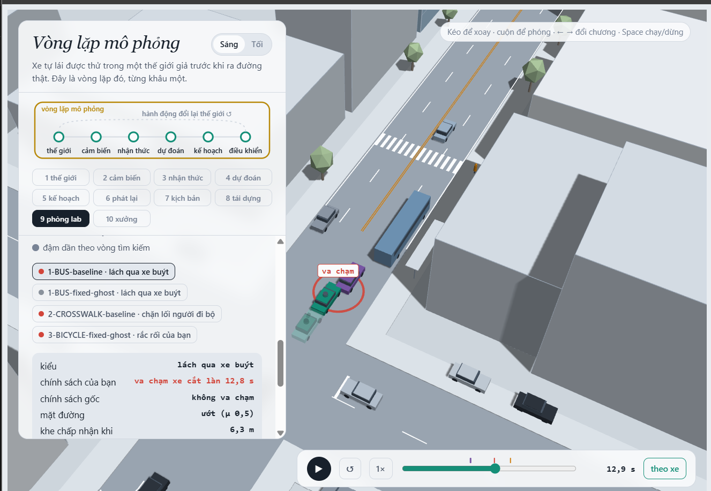
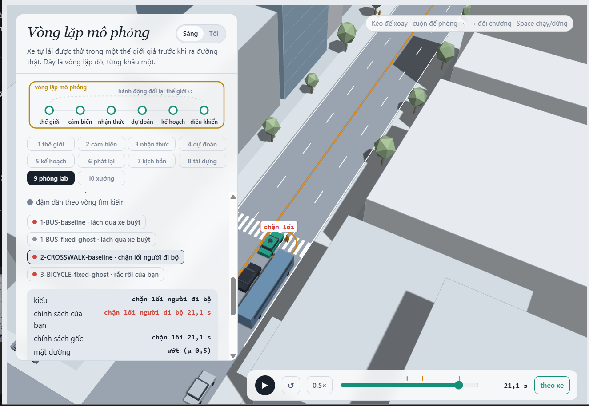
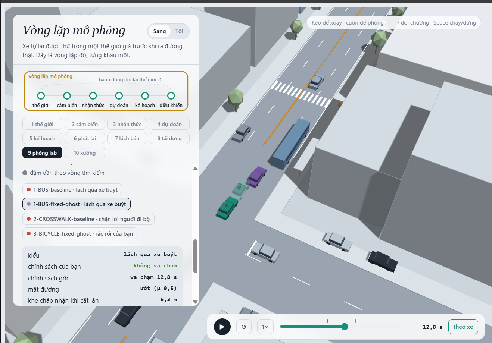
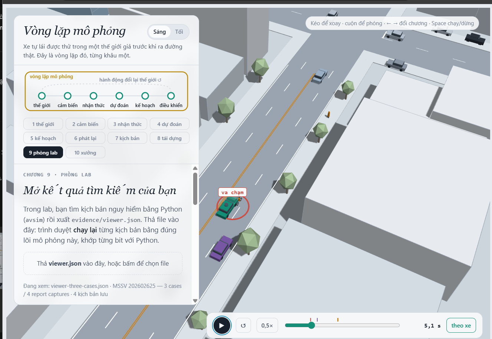

MSSV: 202602625

# Lab 11 · Scenario Forge — báo cáo

Họ tên: Nguyễn Đức Anh. Thị trấn **A** (`meta.json: _run.town`). Evidence được tạo bằng từng bước chạy đầy đủ, không `--quick`; các số làm tròn trong bảng giữ độ chính xác ghi rõ. Các kiểm tra bổ sung trên một cảnh được lưu riêng và được ghi nguồn ở câu tương ứng.

**Trạng thái:** cả 9 câu đã được điền; exposure có căn cứ từ dataset nhưng được dùng dưới dạng cận trên danh định/giả định chuyển miền bảo thủ, không phải tần suất điểm đã đo ở thị trấn A. Đã bổ sung 4 ảnh chụp 3D gốc do người dùng cung cấp; thời gian hiển thị trong ảnh và thời điểm sự kiện được phân biệt trong chú thích.

## 1. Phát lại log có trung thực không? (bước A)

`replay.json: n = 400`, `dropped_human_crash_logs = 0`, `n_used = 400`. Cả 400 log được giữ lại vì người lái không có thất bại ego.

| Trường trong `replay.json` | Phát lại (`replay`) | Phản ứng (`reactive`) |
|---|---:|---:|
| `crashes` | 102 | 0 |
| `contact.rear` | 94 | 0 |
| `contact.side` | 8 | 0 |
| `contact.front` | 0 | 0 |

Các loại không có khóa trong `contact` có số đếm 0. `crash_in_both = 0`. 94/102≈92.16% thất bại phát lại là tiếp xúc phía sau. Planner giảm tốc/dừng khác người lái, nhưng TG vẫn chạy theo log vốn được ghi khi đi sau người lái. TG không có cơ hội phản ứng với vị trí mới của planner; do đó tiếp xúc này là giả đối với phép kiểm thử phản thực. Không thể kết luận planner nguy hiểm từ số va chạm đó.

Ví dụ `replay.json: replay_only[0].scenario = 3`, `contact = rear`, `min_ttc_reactive = 2.555810` s. Kiểm tra bổ sung bằng lõi Python trên đúng tham số này được lưu trong `report_inspection.json: replay_example` (không phải lần ước lượng tỉ lệ mới): TG tiếp xúc ego lúc **20,05 s**, `fake = true`. Tại đó, ego của người lái ở x≈116,86 m, còn planner ở x≈114,67 m; TG phát lại vẫn ở x≈110,07 m, gần như chạm đuôi planner. Trong thế giới phản ứng, TG ở x≈107,55 m và đang phanh, không có sự kiện ego. Chuỗi này cho thấy vấn đề nằm ở việc giữ nguyên hành vi TG trong log.

## 2. Kịch bản bất khả thi (bước B)

`lab11/feasible.py: is_feasible` loại kịch bản nếu bất kỳ điều kiện nào sau đây đúng:

| Luật loại | Căn cứ |
|---|---|
| Gia tốc ngang `(π/cutDur)² × 3.5/2 > μg` | Chuyển làn cosine qua 3,5 m phải có đủ lực bám ngang; yêu cầu quá μg không thể thực hiện trên mặt đường đó. |
| `cutBrake > μg` | Lực phanh yêu cầu vượt giới hạn bám lốp. |
| `pedV > 2.5` m/s | Nằm ngoài miền người đi bộ của lab; không khẳng định ngoài đời không ai chạy nhanh hơn. |
| `cutV <= 0` hoặc `cutV > 22` m/s | Nằm ngoài miền tốc độ xe cắt làn mà lab cho phép, không phải giới hạn phổ quát của xe thật. |

Hàm còn trả `False` với `cutDur <= 0` để tránh thời gian chuyển làn không có ý nghĩa. `g = 9.81` m/s².

| Cuộc săn / trường `hunt.json: <mode>.infeasible` | Số bị loại |
|---|---:|
| `bus_bypass` | 3 |
| `cut_in` | 3 |
| `crosswalk_block` | 10 |
| `rear_ended` | 2 |

`crosswalk_block` có nhiều kịch bản bất khả thi nhất: 10. CEM tối ưu độ nguy hiểm, nên nếu không lọc nó có thể thích chuyển làn quá nhanh, phanh quá mạnh hoặc người chạy quá nhanh: các cách dễ làm planner thất bại nhưng nằm ngoài mô hình vật lý/miền hành vi đã định. Runner không chạy các mẫu đó và không đưa chúng vào elite. Đếm chúng như va chạm sẽ thổi phồng xác suất của sự kiện không thể xảy ra trong miền lab, đồng thời kéo proposal về vùng sai và làm sai trọng số ước lượng. Phép ước lượng ở đây vẫn dùng mẫu số tất cả lần rút, gán mẫu bất khả thi là không thất bại; không tự đổi sang xác suất có điều kiện trên mẫu khả thi.

## 3. Monte Carlo cho bạn biết gì (bước C1)

`mc.json: crashes = 3`, `n = 3000`, `p = 0.001`. Khoảng Wilson 95% là `lo = 0.000340141063`, `hi = 0.002936196810`. Cả ba thất bại thuộc `mc.json: modes.bus_bypass = 3`; `infeasible = 12` và không được đếm là thất bại.

Để nửa độ rộng 95% xấp xỉ `0.2p`, dùng `1.96 sqrt(p(1-p)/n) ≈ 0.2p`, tức `n ≈ 96(1-p)/p ≈ 96/p`. Với p̂=0,001, cần khoảng **96.000 lần chạy**. Đây là quy hoạch ngân sách dựa trên p̂ chưa chính xác, không phải bảo đảm đạt sai số đó ở mọi lần chạy.

`mc.json: per_mode.cut_in.k`, `crosswalk_block.k`, `rear_ended.k` và `other.k` đều bằng 0 trong 3.000 lần. Với từng kiểu này, báo **chưa quan sát thấy; Wilson 95% [0, 0.001278895665]**, lấy `per_mode.<mode>.hi`. Ước lượng điểm bằng 0 là kết quả số đếm, không chứng minh xác suất thật bằng 0; rule of three xấp xỉ cho MC là 3/3000=0,001.

## 4. Importance sampling, ESS và độ suy biến (bước C3)

Các hàng sau lấy từ `estimate.json: seeds[<seed>].per.<mode>`, lần lượt các trường `p`, `hits`, `ess`, `top_share`:

| Seed | Kiểu | p (ước lượng điểm) | hits | ESS | top_share |
|---:|---|---:|---:|---:|---:|
| 0 | `bus_bypass` | 0.00073905283 | 34 | 122.199 | 0.321501 |
| 0 | `cut_in` | 0† | 0 | 125.993 | 0.000000 |
| 0 | `crosswalk_block` | 5.79623499e-07 | 65 | 111.122 | 0.176040 |
| 0 | `rear_ended` | 0† | 0 | 122.161 | 0.000000 |
| 1 | `bus_bypass` | 0.000443615318 | 32 | 123.462 | 0.137290 |
| 1 | `cut_in` | 0† | 0 | 129.381 | 0.000000 |
| 1 | `crosswalk_block` | 1.07366372e-06 | 53 | 134.195 | 0.144802 |
| 1 | `rear_ended` | 0† | 0 | 123.025 | 0.000000 |
| 2 | `bus_bypass` | 0.000245162349 | 35 | 135.120 | 0.148581 |
| 2 | `cut_in` | 0† | 0 | 110.957 | 0.000000 |
| 2 | `crosswalk_block` | 4.43769776e-06 | 55 | 131.183 | 0.577149 |
| 2 | `rear_ended` | 0† | 0 | 112.740 | 0.000000 |

† `cut_in` và `rear_ended` có 0 hit ở cả ba seed: báo thêm **`upper_zero_hits = 0.025`**, không kết luận xác suất thật bằng 0. Cận là `3/(0.2×600)` do proposal phòng thủ q≥0,2p; không dùng 3/ESS. ESS đo độ lệch trọng số, không phải số phép thử độc lập của sự kiện.

`estimate.json: seeds[0..2].total` lần lượt là 0.000739632453117, 0.000444688981918, 0.000249600047167; lớn nhất gấp khoảng 2.963 lần nhỏ nhất. Chúng đều thấp hơn p̂ MC=0,001. Seed 0 và 1 nằm trong khoảng Wilson MC, seed 2 nằm dưới cận dưới; các khoảng xấp xỉ tổng IS vẫn giao với khoảng MC. Có biến động đáng kể, nên chưa thể coi ba seed là một xác suất đã ổn định. Riêng `crosswalk_block` biến động khoảng 7.656 lần giữa seed 2 và 0.

Trường hợp duy nhất `top_share > 0.5` là **`seeds[2].per.crosswalk_block.top_share = 0.5771491244718099`**: một mẫu đóng góp khoảng 57,7% tổng w·y của kiểu đó. Vì vậy giá trị p phụ thuộc mạnh vào trọng số một mẫu. ESS nhỏ chỉ ra trọng số không đều; `top_share` thấp vẫn không chứng minh proposal bao phủ đủ những cách thất bại chưa tìm thấy. CEM có thể co vào một cơ chế rồi bỏ sót các cơ chế khác; việc dừng siết proposal khi elite đạt thất bại giúp hạn chế nhưng không loại bỏ vấn đề này.

`estimate.json: budget = 16800` = 4×(8×300 + 3×600), gồm 9.600 mẫu săn và 7.200 mẫu IS. Ngân sách MC dự kiến cho ±20% với p̂ MC là 96.000, nhưng IS này **chưa đạt ±20%**: nửa độ rộng chuẩn 95% / p của tổng IS ở ba seed xấp xỉ 77,75%, 55,46%, 54,76%, tính từ `1.96×sqrt(sum(per.<mode>.se²))/total` (phần `other` có ước lượng điểm 0).

So riêng sai số chuẩn xấp xỉ, MC để có cùng se với từng seed cần `n≈p(1-p)/se²`, lần lượt khoảng **8.586; 28.074; 51.313** mẫu, dùng p và se của chính seed IS làm giá trị quy hoạch. So sánh này không bao gồm cận các kiểu chưa thấy, không sửa được thiếu bao phủ hay suy biến và không phải chứng nhận IS chính xác hơn MC. Budget 16.800 cũng là ngân sách chung của cả ba seed, không phải 600 mẫu cho toàn bộ quá trình.

`estimate.json: other` lấy từ `mc.json`: k=0, n=3000, ước lượng điểm 0 và `hi = 0.0012788956648046956`. Tổng cộng phần này để tập kiểu thất bại đầy đủ. `other` là nhóm còn lại không có điểm nguy hiểm chuyên biệt, nên không được săn; lấy bằng MC tự nhiên tránh bỏ sót nhóm đó khỏi tổng. Khoảng tổng IS trong file là xấp xỉ, và không được dùng thay các cận riêng của kiểu 0 hit.

## 5. Các kiểu thất bại (bước C2 + 3D)

Các cơ chế dưới đây được kiểm tra bằng lõi Python trên đúng cảnh trong `viewer.json`, lưu bổ sung ở `report_inspection.json: viewer_scenes`; đây là phân tích từng cảnh, không phải ước lượng xác suất mới.

| Kiểu | Cảnh / thời điểm | Chuỗi sự kiện |
|---|---|---|
| `bus_bypass` | B-01, 12,75 s / khung 255 | Xe buýt đứng ở làn E2, C2 đi chậm rồi chuyển ngang để lách nó. Một giây trước va chạm, ego còn coi L1 là xe dẫn; C2 đang lấn làn và chậm hơn ego. Ego nhận C2 muộn, phanh nhưng vẫn tiếp xúc. Người đi bộ còn đứng ở lề; đây không phải lỗi do người bước vào xe. |
| `crosswalk_block` | C-01, 21,10 s / khung 422 | Planner thấy P1 và ego đã dừng, nhưng thân ego ở trên vạch x=122 m. P1 đi tới thân xe rồi phải dừng. Tại sự kiện ego có v=0; thất bại là `kind=block`, không phải người đi bộ đi xuyên vào thân xe. |

Ảnh 3D gốc do người dùng cung cấp, giữ nguyên pixel. Ảnh được chụp từ `viewer-three-cases.json`; `evidence/shots/metadata.json` ghi cảnh, thời gian hiển thị và checksum.

*B-01 / 1-BUS-baseline: vòng đỏ và thân xe cho thấy tiếp xúc ego–C2. Sự kiện xảy ra ở 12,75 s; thanh thời gian của ảnh hiển thị 12,9 s. Cảnh này ghim policy gốc làm xe chính và dùng bản sửa làm bóng mờ; nhãn policy trong bảng giao diện có thể gây nhầm nên xác định vai trò theo cấu hình cảnh.*

*C-01 / 2-CROSSWALK-baseline: ảnh ở 21,1 s hiển thị “chặn lối”; ego dừng trên vạch khiến P1 phải đứng lại.*

| Cuộc săn / `hunt.json: <mode>.found` | Thất bại tìm thấy |
|---|---|
| `bus_bypass` | 145 `bus_bypass` |
| `cut_in` | 22 `bus_bypass`, không có `cut_in` |
| `crosswalk_block` | 41 `crosswalk_block` |
| `rear_ended` | 2 `bus_bypass`, 3 `crosswalk_block`, không có `rear_ended` |

Cuộc săn chưa tìm được `cut_in` hay `rear_ended` trong ngân sách này. MC cũng không có các kiểu đó, nhưng cận Wilson còn khoảng 0,001279; IS 0 hit chỉ cho cận 0,025. Vì vậy độ tin cậy để khẳng định chúng không tồn tại rất thấp. Một cuộc săn chung có thể tập trung vào cơ chế dễ tìm hơn rồi lặp lại nó, như hai cuộc săn `cut_in`/`rear_ended` vẫn thu về kiểu khác. Săn riêng dùng điểm nguy hiểm theo cơ chế để tăng cơ hội tìm kiểu hiếm hơn; không bảo đảm tìm đủ mọi cơ chế.

## 6. Sửa planner (bước E + 3D)

Policy được chọn trên TRAIN là `fix.json: chosen.policy = {"cutinLat": 3.0}`; các núm còn lại giữ mặc định. Ngưỡng ngang lớn hơn giúp planner coi xe đang lấn sang là xe dẫn sớm hơn. Hàm chọn tối thiểu hóa `fail_hi`, giữ ít nhất 95% quãng đường baseline và ưu tiên quãng đường cao hơn khi hòa. Không dùng kết quả TEST để sửa ứng viên hay chọn lại policy.

| Tập / policy | `fail` | `fail_hi_seen` | `fail_hi` | `progress` (m) | `harsh` (khung/kịch bản) |
|---|---:|---:|---:|---:|---:|
| TRAIN / gốc (`baseline_train`) | 0.000274766 | 0.000445789 | 0.000445789 | 213.144820 | 8.339844 |
| TRAIN / chọn (`chosen`) | 0.000000875454 | 0.00000157796 | 0.00000157796 | 213.127196 | 8.023438 |
| TEST / gốc (`baseline_test`) | 0.000204130 | 0.000455414 | 0.001734310 | 214.665933 | 8.146333 |
| TEST / chọn (`chosen_test`) | 0.0000000420338 | 0.0000000795240 | 0.038778975 | 214.623343 | 7.854000 |

Các số trong bảng lấy từ các trường cùng tên trong `evidence/fix.json`. `harsh` là số khung có gia tốc < -3 m/s², không phải số đợt phanh riêng biệt. Trên TEST, quãng đường giảm khoảng 0,01984%, nằm trong giới hạn 5%. Ước lượng điểm và cận của các kiểu có hit giảm, nhưng chưa thể chứng nhận rủi ro rất thấp: `chosen_test.unseen = ["bus_bypass"]`, nên cận của kiểu này là `3/(0.2*400) = 0.0375`. Cộng với `chosen_test.other_crashes.hi = 0.0012788956648046956` và phần có hit cho `chosen_test.fail_hi = 0.03877897518877623`. Không hiểu `unseen` là xác suất thật bằng 0, và không thay `fail_hi` bằng `fail_hi_seen` để làm kết quả đẹp hơn.

**Ảnh so sánh:** `viewer.json: runs` có B-01, baseline va chạm ego–C2 lúc 12,75 s (khung 255); chạy lại đúng tham số với policy đã chọn không có thất bại. Cảnh `1-BUS-fixed-ghost` trong `evidence/viewer-three-cases.json` đặt policy mới làm xe chính và policy gốc làm bóng mờ.

*Ảnh ở 12,8 s trên giao diện (thời điểm sự kiện baseline 12,75 s được làm tròn thành 12,8 s). Xe xanh đặc là bản sửa; bóng mờ là baseline. Bảng bên trái ghi bản sửa không va chạm, policy gốc va chạm.*

**Núm nghe an toàn nhưng có thể phản tác dụng:** tăng khoảng thời gian bám xe `T` từ 1,6 lên 2,0. Trong lần chạy bổ sung `evidence/policy_counterexample.json` (phát lại một cảnh khả thi đã lưu trong `cloud.json`, không phải ước lượng tỉ lệ TRAIN/TEST của `fix`), baseline không có thất bại, còn `T=2` chặn P1 lúc 20,45 s. Khe do ego tạo ra cho phép C2 chuyển làn: tại 15 s C2 đã ở làn ego với `T=2`, nhưng còn ở làn bên cạnh với baseline. Tại 17 s, baseline đã thấy P1 và dừng ở x≈116 m; bản `T=2` còn chưa thấy P1. Bản `T=2` cuối cùng dừng ở x≈119,55 m, quá sát vạch x=122 m, khiến P1 phải đứng lại. Đây là tương tác giữa chuyển làn, thời điểm đến vạch và che khuất, cho thấy thay một núm không chỉ đổi quãng đường phanh của ego. Một phản ví dụ không đủ để kết luận tỉ lệ thất bại tổng thể của `T=2` tăng trong phân phối tự nhiên.

## 7. Từ mô phỏng ra đường thật

Ba giả định cần hiệu chỉnh; giá trị hiện tại là của thị trấn A (`meta.json: _run.town`), không phải số đo thực tế:

| Giả định trong `avsim/space.py` | Dữ liệu thay thế cụ thể | Hướng sai lệch dự kiến nếu giả định sai |
|---|---|---|
| Khe xe chuyển làn chấp nhận: `cutGap` lognormal, median 12 m, sigma 0,5 | Video/CCTV tại đoạn có xe buýt đỗ trên cùng loại tuyến; theo dõi ego/C2 để đo khe trước/sau ngay khi bắt đầu nhập làn, tốc độ tương đối và khoảng bị từ chối. [NGSIM/FHWA](https://www.fhwa.dot.gov/publications/research/operations/its/06135/index.cfm) cung cấp ví dụ dữ liệu quỹ đạo theo thời gian để xây cách đo; dữ liệu cao tốc không được chuyển nguyên phân phối sang con phố có xe buýt. | Nếu người thật nhận khe nhỏ hơn mô hình, mô hình có thể đánh giá thấp tình huống cắt làn/lách xe buýt ở khoảng gần. Khe lớn hơn thường giảm tình huống gắt, nhưng phản ứng qua lại khiến quan hệ không nhất thiết đơn điệu. |
| Xác suất người đi bộ nhìn qua xe buýt: `pedLook=1` với xác suất 0,85 | Camera ở trạm xe buýt/vạch qua đường, gán nhãn người có nhìn vòng qua vật che trước khi bước xuống không, khoảng chờ và các xe họ có thể thấy. Lấy số có nhìn / số lượt đủ điều kiện, có khoảng tin cậy; phân tầng theo góc che và mật độ xe. | Nếu tỉ lệ nhìn thật thấp hơn 85%, mô hình có thể thiếu các lần bước ra khi ego bị che, đánh giá thấp `crosswalk_block`. Nếu cao hơn có thể sai theo hướng ngược; cần chạy lại vì thay thời điểm qua đường còn đổi phản ứng xe buýt/C2. |
| Đường ướt xác suất 0,20; μ khô=0,8, ướt=0,5 | Ghép nhật ký thời tiết/mặt đường theo thời gian của các chuyến với phép đo ma sát tại đoạn đường và loại lốp tương ứng. [FHWA về quản lý ma sát mặt đường](https://highways.fhwa.dot.gov/safety/proven-safety-countermeasures/pavement-friction-management) mô tả đo ma sát liên tục; cần hiệu chỉnh phép đo thành μ có ý nghĩa cho xe/lốp trong mô hình. | Nếu đường thật ướt thường xuyên hơn hoặc μ thực nhỏ hơn, quãng phanh dài hơn và mô hình có thể đánh giá thấp rủi ro. Nếu khả năng bám tốt hơn có thể đánh giá cao hơn, nhưng còn tương tác với việc mẫu chuyển làn có được coi khả thi hay không. |

Các hướng trên là giả thuyết cơ chế cần xác nhận bằng chạy lại trên dữ liệu đã hiệu chỉnh, không phải kết luận nhân quả từ ba seed hiện có. Cũng cần giữ tương quan giữa mưa, tốc độ, khe chấp nhận và hành vi, thay vì mặc định mọi tọa độ độc lập.

## 8. Giới hạn

1. **Một bản đồ và chân trời 24 s:** thế giới có một con phố, vị trí xe buýt/vạch cố định; một lần chạy là 481 khung. Xác suất ở đây không đại diện mọi tuyến, giao lộ hay rủi ro của cả chuyến đi dài. Một sửa đổi đẩy va chạm ra sau 24 s cũng có thể chưa bị phép đo phát hiện.
2. **Hành vi trong một họ mô hình:** xe dùng IDM, chờ khe và các luật nhường đơn giản. Nó không bao phủ đầy đủ giao tiếp, người lái cố tình chen, mức chú ý khác nhau hay phụ thuộc lịch sử. 11 biến chuẩn tắc và 3 biến bật/tắt của prior độc lập là giả định dạy học; kết quả đúng cho giả định đó chưa là kết quả đúng ngoài đường.
3. **Cảm biến và oracle lý tưởng hóa:** quan sát chủ yếu dựa vào hình học che khuất, không mô phỏng đầy đủ nhiễu định vị, mưa làm giảm nhận dạng, nhầm đối tượng và độ trễ hệ thống. Oracle dùng phanh tới μg ngay ở khung có thể biết, chỉ thử phanh và không đánh lái. Nó giúp phân tích một cơ chế, không chứng minh planner thực tế có đủ thời gian và thông tin để tránh.

Nếu có thêm một tuần, tôi sẽ thu/quy chuẩn video ở đoạn có trạm xe buýt để hiệu chỉnh ba prior ở câu 7 và exposure của xe đạp, bổ sung logic dự đoán chuyển ngang/phanh khẩn cấp, rồi đánh giá trên tập tuyến/thời điểm mới chưa dùng để chỉnh. Với kiểu IS không có hit, muốn cận trên thấp hơn 10⁻³ theo `3/(0.2n)` cần hơn khoảng 15.000 mẫu/kiểu, thay vì tuyên bố biến mất từ 400 hay 600 mẫu hiện tại. Tôi cũng sẽ thử độ nhạy với thời gian phản ứng/cảm biến và đo phanh dư cùng ảnh hưởng tới xe bám đuôi.

## 9. Rắc rối của bạn (bước G + chương 10)

**Rắc rối:** xe đạp chậm ở làn E2 chuyển ngang vào làn ego khi ego còn cách 12 m. Cảnh trong `hazard.json` dùng x=0 m, v=3,5 m/s, độ chuyển ngang 2,8 m trong 2,2 s. Nó mô tả xe đạp nhập làn ở khoảng cách ngắn; giả thuyết là planner đợi xe đạp đi vào ngưỡng ngang rồi mới phản ứng, nên phanh muộn dù cảm biến đã có thể nhìn thấy rắc rối. File được dựng bằng công cụ file theo đúng `avsim-studio/1` và kiểm tra bằng `studio.load`, `check_space`, `hazard_ok`; chưa thao tác hay tự lái trong UI chương 10.

**Căn cứ cho `space`:** `hazard.json: why` ghi rõ đây là dải kiểm thử kỹ thuật, lấy mẫu đều để khảo sát độ nhạy, không phải phân phối đo từ đường thật. `h0_v=[2.8,4.4]` m/s (10,08–15,84 km/h) tham khảo thang vận tốc xe đạp chậm trong [FHWA-HRT-05-137, chương 2](https://www.fhwa.dot.gov/publications/research/safety/pedbike/05137/chapter2.cfm), tài liệu tổng hợp nghiên cứu có vận tốc trung bình tại các địa điểm khoảng 10–16 km/h; không coi khoảng trung bình đó là phân phối cá nhân đã hiệu chỉnh. `h0_x=[0,40]` m chọn một đoạn trước xe buýt tại x=106 m, phía trước ego ban đầu x=-40 m. `h0_swerve=[2.65,2.85]` m đưa xe đạp từ tâm E2 z=5,25 m tới z=2,40–2,60 m, giao với hành lang thân ego. `h0_swDur=[2.2,2.6]` s giữ gia tốc ngang cực đại dưới 3 m/s²: trường hợp lớn nhất là π²×2,85/(2×2,2²)≈2,906 m/s². `h0_trig=[10,18]` m nằm quanh thang quãng phanh tối đa của ego ở 12,5 m/s: 9,95 m trên đường khô và 15,93 m trên đường ướt; chuyển động xe đạp và kích thước thân xe còn ảnh hưởng khả năng tránh. Các khoảng vị trí, độ chuyển ngang, thời gian và trigger là lựa chọn kiểm thử dựa trên bản đồ/vật lý, không được gán là số đo ngoài đời.

**Kết quả đầy đủ**, `evidence/mine.json`, 1.500 lần rút mẫu trong giao thông thị trấn A: `accepted=0.994`, tức 1.491 mẫu khả thi, bỏ 9; không có chồng lấn thân xe lúc đầu (`overlap_at_start=0` ở cả hai policy).

| Trường trong `mine.json` | `baseline` | `chosen` (`cutinLat=3`) |
|---|---:|---:|
| `n` | 1491 | 1491 |
| `crashes` | 1172 | 638 |
| `avoidable` | 1171 | 636 |
| `unavoidable` | 1 | 2 |
| `unattributed` | 0 | 0 |
| `low_speed` | 0 | 0 |
| `avoidable_foreknown` | 1171 | 636 |
| `p` | 0.7853789403 | 0.4265593561 |
| Wilson 95% (`lo`, `hi`) | [0.7638196457, 0.8054714417] | [0.4016751805, 0.4518210026] |

Các tỉ lệ trên là **P(lỗi planner | rắc rối được chèn theo dải kiểm thử đã nêu)**. Bản sửa giảm lỗi nhưng vẫn còn 636 thất bại tránh được; nó không giải quyết hết rắc rối mới. `avoidable_foreknown` bằng `avoidable` trong lần quét này, nên không có phần chênh do bị che theo phép đo đó; điều này không khẳng định mọi tình huống xe đạp ngoài đời đều không bị che.

**Exposure từ dataset:** dùng toàn bộ bốn mẫu công khai SinD ở commit `930e4dea78d924c6e9a58ff8e378331f93bba8ec`, nguồn [SinD/SOTIF-AVLab](https://github.com/SOTIF-AVLab/SinD). Dữ liệu CSV có tọa độ mét, thời gian, vận tốc và loại phương tiện; file nguồn/URL/checksum nằm trong `evidence/exposure_dataset/*/manifest.json` và manifest ở thư mục gốc. Phân tích độc lập bằng `python -m lab11.exposure_dataset` được lưu ở `evidence/exposure.json`; đây không phải số đếm từ cuộc quét mô phỏng đã chèn hazard.

| Mẫu SinD | Tổng ô tô | Lượt đủ điều kiện | Xe đạp | Sự kiện chính |
|---|---:|---:|---:|---:|
| Tianjin / 8_2_1 | 268 | 265 | 131 | 0 |
| Changchun / changchun_pudong_507_009 | 1175 | 1172 | 14 | 0 |
| Chongqing / 6_22_NR_1 | 147 | 146 | 0 | 0 |
| Xi'an / Xi'an_412_m1 | 357 | 355 | 40 | 0 |
| Tổng | 1947 | 1938 | 185 | 0 |

Tiêu chí hình học được xác định trước khi đếm, sau đó bổ sung kiểm tra vật lý áp sát trong bước QA: quỹ đạo ô tô dài ít nhất 3 s; xe đạp chạy 2,8–4,4 m/s, ban đầu ở trước 10–18 m và lệch ngang >1,6 đến 4,5 m, cùng hướng trong 30° và tốc độ áp sát dọc >0,1 m/s; trong 2,6 s nó tiến ngang ít nhất 1 m vào hành lang lệch ≤1,6 m và vẫn ở phía trước. Loại trường hợp ô tô đổi hướng quá 15° hoặc lệch ngang quá 0,5 m để không nhầm ô tô rẽ vào xe đạp với xe đạp nhập làn. Mỗi ô tô chỉ được tính tối đa một sự kiện; loại 9 track quá ngắn. Các tiêu chí/ID đủ điều kiện được ghi ở `exposure.json: criteria`, `records[].eligible_car_ids`.

`exposure.json: result.k=0`, `result.n=1938`, nên ước lượng điểm là 0 nhưng không chứng minh sự kiện không tồn tại. Khoảng Wilson danh định 95% là `[0, 0.0019783282014351738]`. Để khảo sát mô hình dưới một giá trị bảo thủ có căn cứ thay vì coi chưa thấy là xác suất thật 0, tôi chọn **cận trên** này làm giả định exposure: `hazard.json: exposure=0.0019783282014351738`; phương pháp được ghi ở `exposure_basis` và `why`. Đây là **cận có nguồn dữ liệu, không phải tần suất dương quan sát được**. Kiểm tra độ nhạy cuối cùng: dải 12–16 m và 8–22 m đều có 0/1938 (`exposure.json: sensitivity`). Bộ dò hình học ban đầu có một ứng viên ở 8–22 m, nhưng kiểm tra vận tốc cho thấy xe đạp đang xa dần ô tô, nên nó bị loại bằng điều kiện áp sát. Kết quả trước QA được giữ ở `exposure_geometric_before_closing_check.json`; số chính 0/1938 và cận trên không đổi. Không nới tiêu chí để ép có hit.

Đơn vị thực nghiệm là **một lượt ô tô quan sát qua giao lộ**, không phải chuyến đi dài hoàn chỉnh. Áp dụng nó cho một lượt qua con phố 24 s của lab, từ giao lộ Trung Quốc sang thị trấn A, là giả định chuyển miền chưa kiểm chứng. Các mẫu công khai có thể không đại diện toàn bộ giao thông; đường xe bị cắt ở biên bản ghi và tương quan giữa các xe cũng hạn chế suy luận, nên mức Wilson 95% chỉ là danh định dưới giả thiết Bernoulli độc lập. Dải `space` của hazard là thử nghiệm kỹ thuật, chưa được fit thành phân phối có điều kiện của SinD. Do đó kết quả nhân exposure chỉ là phép tính của mô hình dưới giả định bảo thủ này, không chứng nhận tần suất ngoài đời mỗi chuyến.

**Quy đổi dưới giả định exposure bảo thủ:** `mine.json: baseline.per_trip = 0.00155373730643`, `baseline.per_trip_hi = 0.00159348686857`; `chosen.per_trip = 0.000843874403832`, `chosen.per_trip_hi = 0.000893850231482`. Tên trường của runner là `per_trip`, nhưng trong phân tích dataset này đơn vị được hiểu là một lượt qua đoạn đường/giao lộ. Các đầu trên này là cận của mô hình với exposure giữ cố định, không phải khoảng tin cậy 95% chung đã bao gồm sai số exposure và chuyển miền.

Đặt cạnh `estimate.json: seeds[1].per.bus_bypass.p = 0.0004436153181961743` (trung vị ba seed cho bus_bypass) và `mc.json: p = 0.001`: hazard xe đạp có quy mô mô hình đáng kể ngay cả với bản sửa. So sánh phụ thuộc mạnh vào giả định dùng cận trên exposure, không chứng minh xe đạp nhập làn nguy hiểm hơn trên đường thật. Dải nhạy theo exposure e vẫn là 0,7853789403×e và 0,4265593561×e; nếu tần suất thực thấp hơn cận đã chọn, các kết quả quy đổi sẽ thấp tương ứng.

**Vì sao chuẩn “tránh được” lạc quan theo hai hướng:** oracle biết chính xác rắc rối đã bắt đầu ngay khi cảm biến thấy, phản ứng không trễ và phanh tới giới hạn lốp; vì vậy nó có thể đếm nhiều hơn số vụ một planner thực tế nhận biết và tránh được. Ngược lại oracle chỉ thử phanh, không đánh lái; có thể tồn tại vụ phanh không cứu nhưng đánh lái cứu được, nên nó đếm ít hơn tập mọi phương án tránh. `unattributed` là thất bại không quy cho hazard; `low_speed` là cờ bổ sung, không cộng thành loại thứ tư.

**Cảnh và ảnh:** `mine.json: exact.planner` có ego–H0 lúc 5,05 s. Kiểm tra bổ sung trên đúng cảnh (`evidence/hazard_scene_check.json`, không phải ước lượng tỉ lệ của `mine`) cho thấy cả baseline và policy được chọn đều va chạm ở khung 101; hazard bắt đầu và oracle phanh ở 3,45 s, tránh được. `3-BICYCLE-fixed-ghost` trong `viewer-three-cases.json` giữ đúng tham số hazard, dùng bản sửa làm xe chính.

*Ảnh gốc hiển thị 5,1 s, sát sau sự kiện 5,05 s, có vòng đỏ “va chạm” tại ego–xe đạp. Đây là cảnh cụ thể trong hazard.json; không suy tỉ lệ 100% từ một ảnh. `viewer.json` cũng có các ví dụ avoidable của cuộc quét.*

**Tự lái:** chưa có dữ liệu điều khiển của người dùng trong bài; kết quả oracle không được báo thành kết quả người dùng tự lái.

**Hướng sửa:** dự đoán hành lang xe đạp từ vận tốc ngang và quỹ đạo tương lai, đánh giá khoảng dừng tương đối ngay khi có dấu hiệu nhập làn, rồi kích hoạt phanh khẩn cấp nếu biên an toàn không đủ. Chỉ tăng `cutinLat` giúp nhận xe lấn làn sớm hơn nhưng chưa đủ, như kết quả của bản sửa cho thấy. Cần kiểm thử logic dự đoán/phanh đó trên dải hazard này và mẫu tự nhiên riêng, đồng thời kiểm tra phanh dư và xe phía sau; chưa triển khai hay khẳng định nó đã giải quyết lỗi.
